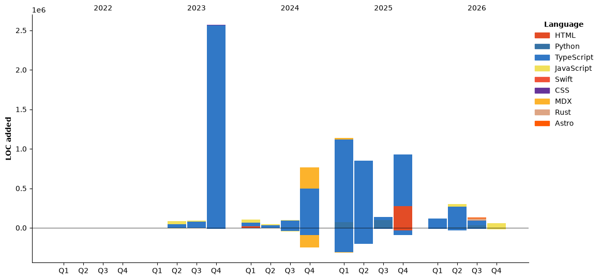

<div align="center">

<!-- 글리치 배너 (svg-banners) -->


<!-- 뱃지 -->
<p>
  <a href="https://moisten.co.kr"></a>
  <a href="https://ruehan.org"></a>
  <a href="https://interactive-portfolio-chi.vercel.app/"></a>
</p>

</div>

## 🌊 `01` — Surface

```yaml
name:       HanGyu
role:       DX & AI Engineer
company:    MOISTEN  ·  Biotech × Beauty (ACHA 기반 수분 테크놀로지)
mission:    시스템 구축  ·  업무 효율화  ·  AI 실무 적용
```

## 🌊 `02` — Descent Log

| 🫧 | 기간 | 소속 | 역할 | 핵심 스택 |
|:--:|:--|:--|:--|:--|
| 💧 | `2021.10 — 2023.03` | **KETI** | Software Researcher | `Python` `Flask` `Vue.js` |
| 💧💧 | `2023.03 — 2025.04` | **Career Transition** | Skill Enhancement | `Learning & Growing` |
| 💧💧💧 | `2025.04 — 2026.10` | **제로원** | S/W Lead Developer | `FastAPI` `React` `React Native` |
| 🌊 | `2026.11 — Present` | **MOISTEN** | **DX & AI Engineer** | `System Design` `AI/LLM` `Automation` |

## 🌊 `03` — Current Dive @ MOISTEN

<div align="center">
<table>
  <tr>
    <td align="center" width="33%">
      <br/>
      <h2>🏗️</h2>
      <h3>System Architecture</h3>
      <p>유통 · 제조 · CS를 잇는<br/><b>통합 디지털 인프라</b> 설계</p>
      <br/>
    </td>
    <td align="center" width="33%">
      <br/>
      <h2>⚡</h2>
      <h3>Digital Transformation</h3>
      <p>반복 업무 자동화와<br/><b>데이터 기반 의사결정</b> 체계 구축</p>
      <br/>
    </td>
    <td align="center" width="33%">
      <br/>
      <h2>🤖</h2>
      <h3>AI Integration</h3>
      <p>LLM 업무 어시스턴트 등<br/><b>현장에 스며드는 AI</b> 도입</p>
      <br/>
    </td>
  </tr>
</table>
</div>

## 🌊 `04` — Logged Expeditions

<div align="center">
<table>
  <tr>
    <td align="center" width="50%">
      <h3>🗑️ 쓸모 (SSEULMO)</h3>
      <p><b>TMS 기반 음식물 폐기물 수거 서비스</b></p>
      <p>📸 사진 기반 용량 측정 · 🤖 AI 폐기물 분석 · 🚛 스마트 수거 최적화</p>
      <sub>@ 제로원</sub>
    </td>
    <td align="center" width="50%">
      <h3>♻️ 담비 (DAMBI)</h3>
      <p><b>IoT 음식물 폐기물 감량기</b></p>
      <p>🌱 친환경 폐기물 처리 · 📊 실시간 모니터링 · ⚡ 에너지 효율 최적화</p>
      <sub>@ 제로원</sub>
    </td>
  </tr>
</table>
</div>

## 🌊 `05` — Toolbox

<div align="center">
<table>
  <tr>
    <td align="center">
      
      
      
      
      
      <br/><sub><b>Frontend</b></sub>
    </td>
    <td align="center">
      
      
      
      
      
      <br/><sub><b>Backend</b></sub>
    </td>
    <td align="center">
      
      
      
      
      <br/><sub><b>Mobile · DB</b></sub>
    </td>
    <td align="center">
      
      
      
      
      
      <br/><sub><b>DevOps · Tools</b></sub>
    </td>
  </tr>
</table>

<sub>🤖 AI / Automation — new gear for the deep dive</sub>
<p>
  
  
  
  
</p>

</div>

## 📡 Sonar — Signals from the Deep

<div align="center">


<table>
  <tr>
    <td></td>
    <td></td>
  </tr>
  <tr>
    <td></td>
    <td></td>
  </tr>
</table>

<!-- 기여도 캘린더 (ghchart) -->


<br/>


</div>

 <!--START_SECTION:waka-->


**저는 아침형 인간이에요. 🐤** 

```text
🌞 아침                     1314 commits        ████░░░░░░░░░░░░░░░░░░░░░   15.78 % 
🌆 낮　                     5111 commits        ███████████████░░░░░░░░░░   61.39 % 
🌃 저녁                     1158 commits        ███░░░░░░░░░░░░░░░░░░░░░░   13.91 % 
🌙 밤　                     743 commits         ██░░░░░░░░░░░░░░░░░░░░░░░   08.92 % 
```


📊 **저는 이번주를 이렇게 시간을 보냈어요.** 

```text
🕑︎ Timezone: Asia/Seoul

💬 프로그래밍 언어들: 
이번 주에 활동은 없어요.

🔥 에디터들: 
이번 주에 활동은 없어요.

💻 운영 체제들: 
이번 주에 활동은 없어요.
```

🤖 **AI Coding This Week** 

```text
No AI Coding Activity Tracked This Week
```

**타임라인**




 Last Updated on 31/10/2026 21:50:17 UTC
<!--END_SECTION:waka-->

<div align="center">

<sub>🌊 Stay Hydrated — the deeper you go, the clearer it gets.</sub>

</div>
